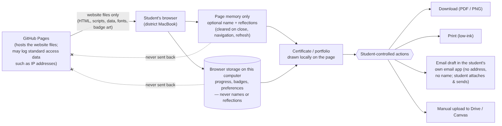

# Speaking Lab 2.0 — Student Privacy and Data Handling

**Prepared for:** district technology and student-privacy leadership, before formal classroom adoption.
**Prepared by:** the development team for Steven Bennett (Speech & Communication, Wyandotte High School). November 24, 2026, development branch `dev`.

**Status:** this is a description for review. **It is not a legal determination.**
- Speaking Lab has **not** been reviewed or approved by the district.
- This document does **not** claim FERPA, COPPA or any other compliance.

**Guiding principle:** Speaking Lab delivers educational content; it does not collect student information.

## 1. Hosting architecture
| Part | What it is |
| --- | --- |
| **Hosting** | GitHub Pages (static website hosting by GitHub). The site is a set of fixed files: HTML, JavaScript, JSON course data, self-hosted fonts, images, audio and video. Production: `https://stevenbennett-hub.github.io/speaking-lab/`. A separate preview site is used for testing. |
| **Server code** | None. Speaking Lab runs no server, database, API, account system, analytics, advertising or tracking script, and no third-party script is loaded. |
| **What GitHub may collect** | GitHub Pages, like any web host, may independently record standard access information (for example IP addresses, request times, browser type) for security and operations. Speaking Lab cannot see or control those logs. They are governed by GitHub's own policies, not by Speaking Lab. |
| **What the student's browser receives** | The website files only. |
| **What the student's browser sends back** | Ordinary requests for those same website files. No form, field or student-entered text is sent (see the audit, §9). |

*Intended design: the website files flow to the browser. Progress stays in that browser. Certificates are drawn on the page. Only the student moves a document onward, by downloading, printing, emailing or uploading it. Nothing the student types flows back to GitHub. §9 lists which parts of this were independently verified.*

## 2. Data stored in the student's browser (instructional data)
Speaking Lab stores learning progress in the browser's `localStorage` on that computer. It is not synchronized anywhere.

| Key (examples) | Holds | Personal information? |
| --- | --- | --- |
| `speakup-path`, `speakup-group`, `speakup-lang`, `speakup-theme`, `speakup-support-level`, `speakup-prefs-v1` | Pathway (high school / learning English / college), odd or even class periods, language, appearance, language-support preference, sound and motion settings | No |
| `speakup-quiz-v1`, `speakup-test-v1`, lab keys (`speakup-aud-v1`, `speakup-listen-v1`, `speakup-plab-v1`…), `speakup-btp-v1`, `speakup-ai-v1`, `speakup-research-v1` | Practice answers, scores and dated mastery records from activities | Practice work only. Some activities let students type answers, so students are told not to include private information. |
| `speakup-achieve-v1` | Which badges are earned, and the date each was first recorded | No |
| `speakup-journal-v1` | Typed journal entries, only for students Mr. Bennett has allowed to type journals | Student writing, kept only in this browser. It may contain personal information the student chose to write. |
| `speakup-checklist-v1` | Which learning-checklist tasks the student checked off, or reported submitting in Canvas, with dates (task ids and dates only) | No |
| `speakup-backup-v1`, `speakup-unlock-v1` | The date of the last backup or reminder; which units the student has opened | No |
| `speakup-teacher-*` | Teacher drafts and notes (teacher's own browser) | Teacher data; never in student backups |

- **Voluntarily entered information.** Speaking Lab never asks for personal information. Practice responses and typed journals are free text, though, so a student may choose to type personal details into them. That text stays in this browser and is included in the student's own progress backup file (§4). It is never sent anywhere by Speaking Lab.
- **Progress is not an official record.** It can be erased by clearing the browser, and it can be edited by anyone with access to that browser.
- **Canvas remains the official system** for assignments, submissions, assessment and grades.

## 3. Achievements and mastery
- Badges are calculated in the browser from activity results (`js/achievements.js`). Learning points are recalculated each time, so repeating an activity never adds points twice.
- **Teacher-verified speaking badges stay "pending"** until a real teacher verification process exists. No online activity can award them.
- **Badges are practice records.** They are informal learning records, not credentials. Because they live in the browser, they are **not tamper-proof or independently authenticated**.

## 4. Progress backup and restoration
- **Backup:** *Preferences → Back up or restore my progress*, or *My Achievements → Back up my progress*. This downloads a JSON file of the student's `speakup-*` items. The college and teacher codes and typed-journal permission are excluded, and so is every `speakup-teacher-*` item.
- **Where to keep it:** students are encouraged to save the file in their district Google Drive.
- **Restoring:** loading that file restores the progress. The student must confirm first, because it replaces what is saved on that computer.
- **What a backup contains:** the student's practice responses, scores and typed journals. These may include personal information the student chose to type.
  - The backup dialog tells students this, and asks them to keep the file in their own Drive and not share it.
  - The file is created on the student's computer and is controlled by the student. Speaking Lab never uploads it.
- **Never in a backup:** student names, email addresses and portfolio reflections. They are never stored, so they cannot be included.
- **Certificates and portfolios** are human-readable records. They cannot restore progress or prove eligibility for a badge.
- **Reminders:** a gentle reminder appears on My Achievements at most once a week, and only after something has been earned. It can be dismissed for a week.
- **Ad Detective** (a separate site) keeps its own records. Speaking Lab reads only its small mastery summary. The Speaking Lab backup and portfolio do **not** claim to include Ad Detective's full records.

## 5. Optional certificate personalization (names)
A student may type a name to appear on a certificate or portfolio. **The name is optional.** Every document can be made anonymously.

| Requirement | How it is met |
| --- | --- |
| Temporary, in page memory only | Held in a JavaScript variable (`NAME` in `js/certificates.js`) while the certificate or portfolio view is open |
| Never stored | Never written to `localStorage`, `sessionStorage`, cookies or IndexedDB. The code has no such calls; the tests and the audit check this. |
| Never transmitted | No network call exists in the certificate code. The audit observed no request containing the name. |
| Never in URLs | No form, no query strings, no hash changes with the name |
| Never in backups, filenames or metadata | Filenames are generic (`speaking-lab-bridge-builder.pdf`). The PDFs are written without any metadata dictionary. PNG files carry no text chunks. |
| Cleared | When the student leaves the view, opens another certificate, or refreshes |
| No browser remembering | `autocomplete="off"`, no form; spell-check is turned off on these fields |
| Safe text | The name is drawn as text on a canvas and escaped when shown in the field; it is never inserted as HTML |

**Visible, not hidden.** When a student chooses to type a name or reflection and then exports, prints or shares the document, that text appears **visibly** on the page of that copy. This is intended. It is still not sent anywhere by Speaking Lab, and it is never added to hidden document information (PDF metadata, PNG text chunks) or to the filename. Once a student has made a copy, what happens to it is up to the student.

The app shows a second note beside the field: *"Your name and reflection answers appear only where you can see them on the document. Speaking Lab never sends them anywhere and never adds them to hidden file information (metadata) or to the file name."*

The notice shown beside the field: *"Adding your name is optional. Speaking Lab uses it temporarily in your browser to personalize your certificate. Your name is not saved by the application or sent to our website host. If you download, print or share your certificate, your name will appear on that copy."*

## 6. Portfolio reflections
- **Optional.** Five end-of-course reflection questions can be included in the exported portfolio.
- **Same rules as names:** page memory only; never stored, sent or put in backups; cleared on leaving or refreshing.
- **Students are warned** to download or print before leaving the page. They are also told not to include private information.
- **No AI and no grading.** No AI is used, and reflections are not graded.

## 7. Documents and sharing workflows
- **Generated locally.** Certificates (US Letter, full-color and low-ink) and portfolios are drawn on the page with the site's own fonts and badge artwork. They are saved as PNG, or as PDF written by Speaking Lab's own code. There is no library or external service.
- **Printing** uses the browser's print dialog and defaults to the low-ink style. "Save as PDF" is available there too.
- **Email to Myself:**
  - Speaking Lab prepares a **generic** subject and message and can open a `mailto:` draft. The draft has **no recipient** and **no name**.
  - Speaking Lab does not send email, and it collects no email address.
  - The student types their own address, attaches the downloaded file manually and sends it.
  - Copy buttons support district webmail when no mail app is configured. No email provider is assumed.
- **Canvas:** students upload a downloaded file to a Canvas assignment when Mr. Bennett asks. There is **no Canvas API or LTI integration**, and nothing is sent to Canvas automatically.

## 8. Other existing resources and controls
- **External instructional content:**
  - YouTube videos, the LibreTexts textbook, Google Slides decks, research databases, ClassLink and similar sites are **links**. They open only when a student clicks them, and then that site's own policies apply.
  - No YouTube player or other third-party content is embedded, and none loads automatically.
  - The course videos stored on the site (Beyond the Podium, the welcome video) are served from GitHub Pages like the other files.
- **Ad Detective:** a separate static site on the same host. Its records stay in that site's browser storage.
- **College pathway:** off by default. The instructor code is a **client-side deterrent, not security**. Choosing it does not enroll anyone or award credit.
- **Teacher view:** a classroom convenience code checked in the browser. It is **not authentication**: anyone who learns it can open the teacher tools in their own browser. It grants no access to any student's data, because no student data leaves student browsers.
- **Preview vs production:**
  - The development preview is a separate website, and its browser storage is kept separate from the real site's.
  - Production never requests preview configuration.
  - Documents generated on the preview carry a visible **DEVELOPMENT PREVIEW** label.

## 9. Privacy audit: method and results (November 24, 2026)
**Method:**
- An automated Chromium browser (Playwright) ran Speaking Lab from a local copy of the site files.
- It used fictional data with unique test strings: the name "Zqx Fictional-Student 7731" and a reflection beginning "ZQXREFL-4488".
- It went through the 16 actions in the brief: opening the certificate view; entering, editing and switching styles; generating, downloading and printing certificates; saving as PDF; generating the portfolio and entering reflections; downloading the portfolio; preparing an email draft; downloading a progress backup; closing; navigating away; refreshing.
- **After every step it inspected:**
  - every network request (URL, method, body, type, including beacons);
  - `localStorage`, `sessionStorage`, IndexedDB and cookies;
  - the page address.
- **At the end it inspected:**
  - the console log;
  - every downloaded file, by its bytes, PDF metadata, PNG text chunks and filename;
  - the progress backup file.

**Results** (`docs/privacy/AUDIT_RESULTS.txt`): **60 of 60 checks passed.**
- No request contained the name or reflection. There were **no** POST requests, beacons or request bodies, and **no** third-party requests at all.
- The name and reflection were never found in browser storage, cookies, IndexedDB, the URL, the console, the backup file, filenames or file metadata.
- The name and reflections were cleared after closing, navigating away and refreshing.
- Certificate generation made no network requests beyond the site's own files.
- **Requests that happen independently of certificates** (all to the site itself):
  - the course data, scripts, fonts and media;
  - the Respectful Audience Lab's narration audio files, which it checks for on load;
  - on a local or preview copy, a request for `data/preview.json`. Its 404 is normal on a production-like copy.

**What this audit cannot show:**
- GitHub's internal hosting logs;
- the district's device-management, filtering or browser-sync systems;
- browser extensions;
- what an email provider, Google Drive or Canvas does with a file after the student shares it.

Browser features outside Speaking Lab's control may also apply. Examples are a district policy that syncs form data, or "enhanced" spell-check services; spell-check is turned off on these fields for that reason.

## 10. Remaining limitations
- Browser-stored progress can be lost (cleared data, a different computer) unless the student keeps a backup.
- Achievements and certificates are not tamper-proof. Anyone controlling a browser can alter its records. They should not be used as evidence for grades; Canvas is the record.
- A printed or downloaded document with a name on it is under the student's control once created.
- Students may type personal information into practice activities or typed journals despite the guidance. That text stays in the browser and the student's own backup file, which the student controls.
- Names and reflections that a student puts on an exported document are visible on that copy by design.
- **Accessibility:** exported PDFs are page images, so they are not yet accessible to screen readers. An accessible text-based PDF or an HTML export is on the accessibility roadmap.

## 11. Recommendations for district review
1. Review this document, the audit results and the student-facing notices, ideally in a district browser on a district MacBook.
2. Confirm that GitHub Pages hosting is acceptable under district policy. If preferred, consider district-controlled static hosting; the site needs no server.
3. Confirm the district's email and Drive guidance for students saving their own documents.
4. Decide whether the teacher-view and college codes are acceptable as classroom conveniences, understanding that they are not security.
5. Re-run the audit (`tests/tools/privacy-audit.py`) after any future change to certificates, portfolios or sharing.
